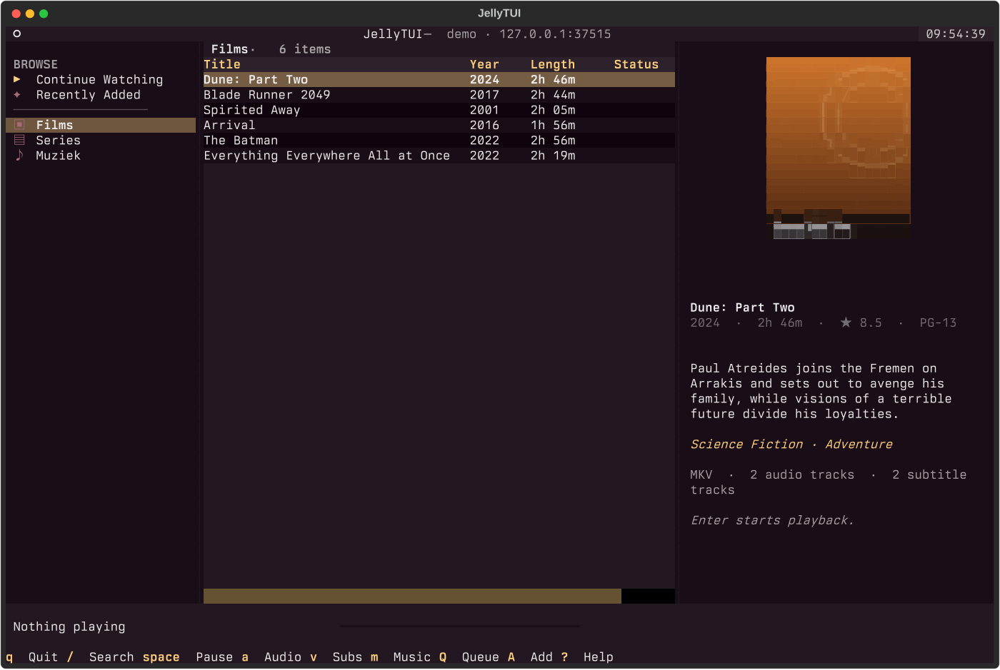
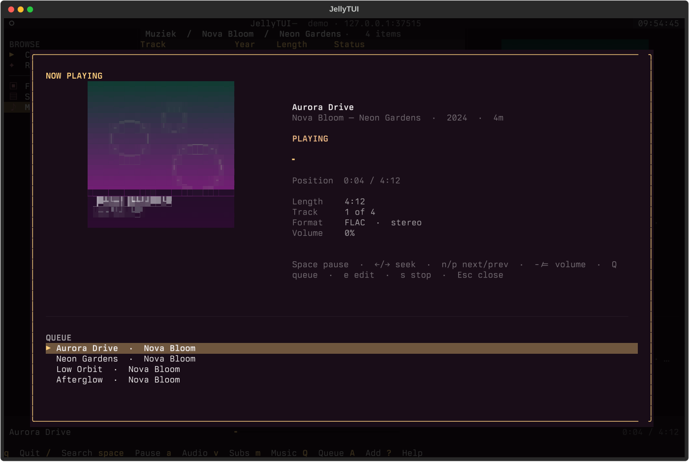
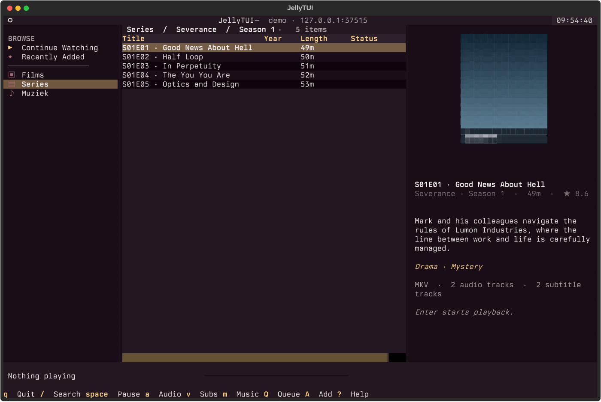
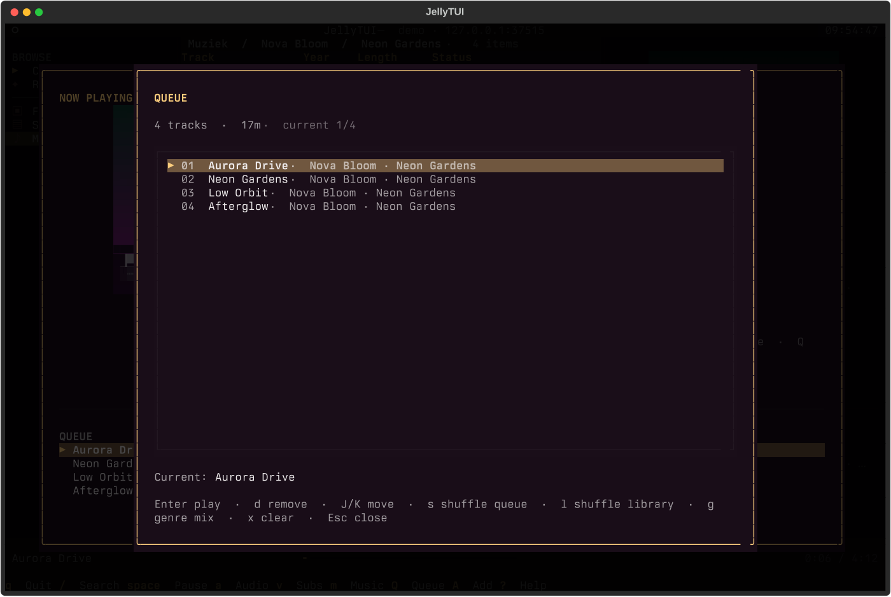

# JellyTUI

A keyboard-driven [Jellyfin](https://jellyfin.org) client for the terminal,
styled with [Textual](https://textual.textualize.io) and playing media in
[mpv](https://mpv.io).

```
▶  JellyTUI
   Jellyfin in your terminal
```

Browse your libraries, jump into a show's seasons and episodes, resume what you
were watching, search the whole server, switch audio and subtitle tracks, build
music queues, and keep your Jellyfin progress in sync — all without leaving the
terminal.

## Screenshots





| Series and episodes | Queue management |
|:---:|:---:|
|  |  |

_Screenshots use a synthetic demo library with generated artwork._

## Features

- **Browse** movies, shows, seasons, episodes, collections, music artists,
  albums and tracks from every Jellyfin library.
- **Continue watching** and **Recently added** views, plus server-wide search.
- **Direct playback in mpv** using the Jellyfin direct-play URL. A separate mpv
  window opens for video.
- **Music without mpv**: audio tracks can play through an ffmpeg → PipeWire/
  PulseAudio/ALSA backend (the default when available), with queueing and
  automatic next-track playback. Video still uses mpv.
- **Music player interface** (`m`): large cover art, track details, progress,
  controls and the current album/queue. A compact Now Playing track panel also
  stays visible in the details column while you browse.
- **Audio and subtitle track picker** (`a` / `v`). Embedded tracks are selected
  directly in mpv; separate subtitle files hosted by Jellyfin are added to mpv
  on demand. Image-based subtitles (PGS/VobSub) work too, since mpv renders
  them from the container.
- **Resume prompt** when an item has a saved position, and progress is reported
  back to Jellyfin while playing (every 10 seconds, on pause and on stop).
- **Watched toggle** (`r`), stored on the server.
- **Metadata editing** (`e`): edit the title, sort/original title, overview,
  year, genres, tags, ratings, and (for music) album, artists and track/disc
  numbers directly in Jellyfin.
- **Cover art** in Kitty/Sixel terminals via the Kitty graphics protocol or
  Sixel. On other terminals JellyTUI renders art with
  [chafa](https://hpjansson.org/chafa/); without chafa it falls back to a clean
  text-only layout.
- **Live Omarchy and pywal theming**: the TUI follows the current Omarchy theme
  or pywal palette and repaints when either changes, without a restart.
- **Language preferences** for audio and subtitles, including forced subtitles.
- Everything is keyboard-driven and sized for real terminals.

## Requirements

- Python 3.12+
- [mpv](https://mpv.io/installation/) on `PATH` for video
- [ffmpeg](https://ffmpeg.org/) on `PATH` for the mpv-free music backend
- PipeWire (`pw-play`), PulseAudio (`pacat`) or ALSA (`aplay`) for music output
- A Jellyfin server (tested against Jellyfin 12.x)
- Optional: [chafa](https://hpjansson.org/chafa/) for cover art on terminals
  without Kitty/Sixel graphics
- Optional: a terminal with Kitty graphics (Kitty, WezTerm, Ghostty, …) or
  Sixel support for pixel-perfect artwork

## Install

Clone the repository and run the installer. It checks for `mpv` and `chafa`,
offers to install missing system packages, and installs or updates the
`jellytui` command. It prefers [uv](https://docs.astral.sh/uv/) and falls back
to [pipx](https://pipx.pypa.io/) when uv is unavailable; if neither is present
it installs uv.

```sh
git clone https://github.com/ekollof/JellyTUI.git
cd JellyTUI
./install.sh
```

Useful installer options:

```sh
./install.sh --yes       # don't prompt before installing system packages
./install.sh --pull      # git pull --ff-only before reinstalling
./install.sh --no-deps   # don't touch mpv/chafa
./install.sh --no-dev    # don't update a local .venv
```

Alternatively, install it directly with uv:

```sh
uv tool install .
jellytui
```

Or run it from a checkout without installing:

```sh
uv sync
uv run jellytui
```

For development, install the project and its test dependencies in editable mode:

```sh
uv sync
uv run pytest
```

## Usage

```sh
jellytui --server http://your-server:8096
```

Enter your username and password on the login screen. JellyTUI stores the
resulting access token (not your password) in
`~/.config/jellytui/config.json`, with file mode `0600`. The device ID and
language/playback preferences live in the same file.

### Options

```
--server URL             Jellyfin URL, including any base path
--username NAME          Prefill the username
--logout                 Forget the saved session
--mpv PATH               Path to the mpv executable
--mpv-arg ARG            Extra argument for mpv (repeatable)
--audio-backend MODE     auto | ffmpeg | mpv
--audio-device DEVICE    Output device/target for the ffmpeg music backend
--ffmpeg PATH            Path to the ffmpeg executable
--audio-language LANG    Preferred audio language (eng, en, English, …)
--subtitle-language LANG Preferred subtitle language
--subtitles MODE         auto | off | forced
--no-images              Disable cover art
--graphics MODE          auto | kitty | sixel | chafa | text
--theme SOURCE           auto | omarchy | pywal | jellyfin
--no-theme-watch         Don't watch palette files for live changes
--no-progress-report     Don't report progress to Jellyfin
--diagnostics            Print graphics/theme/audio/chafa/mpv detection details
--config PATH            Use a different config file
```

Environment overrides:

- `JELLYTUI_CONFIG` — config file path
- `JELLYTUI_GRAPHICS` — force a graphics backend (`auto`, `kitty`, `sixel`, `chafa`, `text`)
- `JELLYTUI_CHAFA` — path to chafa
- `JELLYTUI_THEME` — force a theme source (`auto`, `omarchy`, `pywal`, `jellyfin`)
- `JELLYTUI_OMARCHY_COLORS` — path to an Omarchy `colors.toml`
- `JELLYTUI_PYWAL_COLORS` — path to a pywal `colors.json` or `colors` file

Run `jellytui --diagnostics` to see exactly what was detected.

## Music browsing

The music library follows the artist hierarchy: **Artist → Album → Track**.
Open an artist to see their albums, then an album to see its track list with
track numbers, lengths and played state. The first column is labelled Artist,
Album or Track depending on where you are, and the details column shows the
selected artist, album or track (including artist, album, year, genres and
format). Search results still show a flat list across all item types.

## Queue management

Press `Q` to open the music queue. The queue screen shows the current track,
the full queue and its total running time. From here you can play an entry with
Enter, remove the highlighted entry with `d`, reorder with `J`/`K`, shuffle the
queue with `s`, or clear it with `x`.

The queue can be built from the browser:

- `A` adds the selected track, album or artist. Albums and artists expand to
  their tracks; duplicate tracks are not added twice.
- `Ctrl+A` adds all music in the current view. In a music library this queues
  the whole library; in search results it expands the matching albums and
  artists.
- `F` shuffles the entire music library and starts playing immediately.
- `M` starts a Jellyfin instant mix from the selected track, album or artist.
- In the queue screen, `l` shuffles the library and `g` opens a genre picker
  for a Jellyfin genre instant mix.

Queue additions never interrupt playback; they append and start playing only
when you select an entry in the queue screen (or use a shuffle/mix action).
Jellyfin's instant-mix endpoints use the server's configured metadata providers
and listening data, so genre mixes work best with MusicBrainz metadata and some
play history.

## Music playback

By default (`audio_backend = "auto"`), audio items use an mpv-free backend:
`ffmpeg` decodes the Jellyfin stream to PCM and passes it to the system sound
server through `pw-play` (PipeWire), `pacat` (PulseAudio) or `aplay` (ALSA).
Video continues to use mpv. If ffmpeg or an output tool is unavailable, music
falls back to mpv automatically.

When you play a track from an album or list, JellyTUI queues the other audio
items in that view and advances to the next track when one ends. The details
column shows a live track panel with the title, artist/album, position, length
and volume while you keep browsing. Press `m` for the full music player: large
cover art, labelled track length/position/format, and the queue. Space pauses,
the arrow keys seek, `n`/`p` change tracks, `e` edits the current track's
metadata, `s` stops, and Escape returns to browsing.

Use `--audio-backend mpv` to force mpv for music, or `--audio-device` to pick
a PipeWire/PulseAudio target. This backend is Linux-focused; on systems
without one of those tools, JellyTUI uses mpv.

## Metadata editing

Press `e` on any item in the browser to open the metadata editor. From the
music player, `e` edits the currently playing track. The editor updates the
common Jellyfin fields: title, sort title, original title, overview, year,
community and official ratings, genres, tags, and for music also album,
artists, album artists and track/disc numbers. List fields use semicolons
rather than commas, so names and tags that contain commas survive intact.

Changes are written to Jellyfin through its item update API. Metadata editing
requires an elevated/administrator Jellyfin account; other accounts will see
the server's permission error in the dialog. Images, provider IDs, people and
other provider-specific metadata are left untouched.

### Remote lookup

The editor has context-aware lookup buttons backed by Jellyfin's remote
metadata providers (MusicBrainz for music, and whichever movie/series providers
the server has enabled):

- A **track** offers *Look up album* (updates the linked album) and *Look up
  artist* (updates the linked artist).
- A **music album** offers *Look up album* and *Look up artist*.
- A **music artist** offers *Look up artist*.
- Movies, series, box sets and music videos offer *Look up metadata*.

The lookup dialog searches by name and year, lists matching releases with their
provider IDs and overview, and applies the selected result to the target item.
Applying replaces the target's metadata and refreshes it from the provider;
uncheck *Replace images* to keep the current artwork.

Remote lookup requires the same elevated account as editing, and the relevant
metadata provider must be enabled in Jellyfin. For music, enable the
MusicBrainz provider under **Dashboard → Plugins → Metadata**.

## Theming

By default (`theme = "auto"`) JellyTUI follows, in order:

1. The current **Omarchy** theme at
   `~/.local/state/omarchy/current/theme/colors.toml`
2. A **pywal** palette at `~/.cache/wal/colors.json` or `~/.cache/wal/colors`
3. The built-in Jellyfin theme

The palette is re-read once a second. Running `omarchy theme set …` or
`wal -i …` recolours the interface — including tables, dialogs, progress
accents, the sidebar and the header — while it is running. Files are replaced
atomically by these tools, so JellyTUI re-checks the paths instead of holding
them open.

Use `--theme pywal` to prefer pywal on an Omarchy machine, `--theme jellyfin`
to ignore both, or `--no-theme-watch` to read the palette only at startup. A
theme switch is also reported with a short notification. JellyTUI only reads
these files; it never changes Omarchy's or pywal's configuration.

`jellytui --diagnostics` prints the resolved theme source, its title and the
palette paths it found.

## Keys

| Key | Action |
| --- | --- |
| `↑` / `↓` | Move through lists |
| `←` / `→` | Move between the sidebar and the item list |
| `Enter` | Play, or open a show/season/album |
| `Backspace` / `Esc` | Go back |
| `/` | Search the whole server |
| `Ctrl+R` | Refresh |
| `Space` | Pause / resume |
| `,` / `.` | Seek 10 seconds |
| `Shift+←` / `Shift+→` | Seek 10 seconds |
| `[` / `]` | Seek 1 minute |
| `-` / `=` | Volume down / up |
| `a` | Choose an audio track |
| `v` | Choose a subtitle track |
| `m` | Open the music player |
| `n` / `p` | Next / previous music track (in the player) |
| `Q` | Open the music queue |
| `A` | Add the selected track/album/artist to the queue |
| `Ctrl+A` | Add all music in the current view to the queue |
| `F` | Shuffle-play the entire music library |
| `M` | Start an instant mix from the selected item |
| `e` | Edit the selected item's metadata |
| `S` | Stop playback |
| `r` | Mark watched / unwatched |
| `i` | Toggle cover art |
| `L` | Log out |
| `q` | Quit |

## Graphics detection

At startup JellyTUI asks the terminal whether it supports the Kitty graphics
protocol or Sixel, using the same protocol probe as `textual-image`. If either
is available, the Jellyfin logo on the login screen and cover art in the
details pane are rendered as real images.

If the terminal has no graphics support, JellyTUI uses `chafa` to render the
logo and cover art as ANSI art. If chafa is not installed, the interface stays
fully functional with a text-only layout.

The `--graphics` flag is useful for testing or for terminals where the probe
cannot get an answer (for example through some multiplexers):

```sh
jellytui --graphics kitty
jellytui --graphics chafa
jellytui --graphics text
```

## Notes and limitations

- JellyTUI always requests **direct play** and lets mpv handle the container.
  This keeps A/V quality intact and track switching instant, but it does not ask
  Jellyfin to transcode. Formats mpv cannot decode will fail to play.
- Playback progress is reported as `DirectPlay`; Jellyfin's "now playing"
  dashboard shows the session accordingly.
- Live TV, plugin content and playlist editing are not implemented.
- The mpv window has its own keyboard controls (space, arrows, `f`, `9`/`0`,
  subtitles via `j`, etc.) in addition to the TUI controls.

## Development

```sh
uv sync
uv run pytest
```

The test suite includes unit tests for the API client and models, an mpv IPC
integration test using a generated video with multiple audio/subtitle tracks,
ffmpeg audio-backend tests, Textual UI smoke tests, a full video playback test
with progress reporting, a music test that verifies queueing, the music player
and automatic next-track playback, and metadata-editor tests that check the
preserved-field update payload. Optional live tests run against a
real server when `JELLYFIN_URL`, `JELLYFIN_USERNAME` and `JELLYFIN_PASSWORD`
are set.

## Credits

The Jellyfin icon in `jellytui/assets/` comes from the
[Jellyfin UX repository](https://github.com/jellyfin/jellyfin-ux) and is used
under CC-BY-SA-4.0. Jellyfin is a trademark of the Jellyfin project. JellyTUI is
an independent client, not affiliated with or endorsed by the Jellyfin project.

Media playback is powered by mpv. Terminal UI by Textual. ANSI art fallback by
chafa.
